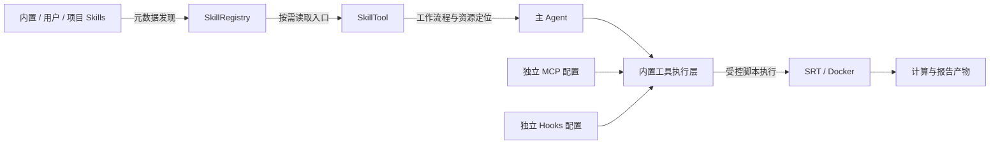

# ResearchX 高优先级问题修改方案

| 项目 | 内容 |
|---|---|
| 分析对象 | OpenHarness 仓库中的 ResearchX Agent 投研工作台 |
| 文档日期 | 2026-10-13（Asia/Shanghai） |
| 文档用途 | 技术评审、开发拆分、迁移安排及验收依据 |
| 当前状态 | 修改方案；代码示例为拟新增接口或控制流程，不代表已经实施 |
| 分析基线 | 当前工作区，包含已有未提交改动，不只针对 Git HEAD |
| 范围 | 四项高优先级问题；不包含中、低优先级优化 |

## 1. 范围与已确认决策

本次修改范围为：

1. Runtime 生命周期与资源清理。
2. MCP 参数契约完整性。
3. 请求与执行轮次持久化。
4. 删除 ResearchX 插件体系，业务扩展统一采用 Skills。

第四项按照用户后续决定调整为去插件化：业务扩展通过 `SKILL.md + scripts/references/templates` 提供，保留内置工具执行层、独立 MCP 和独立 Hooks。共享计算及报告代码迁移到 Skills 支持模块。

### 1.1 已确认的设计约束

| 决策 | 最终约束 |
|---|---|
| 崩溃恢复 | 重开会话恢复记录与状态，不自动调用模型；成功工具结果复用，不确定副作用先核对 |
| 持久化粒度 | 已接受请求、完整模型响应、工具执行意图及已提交结果必须保留；未提交文本增量允许在崩溃时丢失 |
| MCP 参数 | 按原始 Schema 严格验证；不隐式转换类型、不静默删除字段、不省略显式 `null` |
| Schema 外部引用 | 默认不下载远程引用，只接受本地引用或宿主预先登记的定义 |
| 客户端所有权 | 默认由 Runtime 接管传入客户端；借用必须显式声明并由调用者关闭 |
| 持久化故障 | 必要检查点失败即停止执行；工具意图未提交时不得执行工具 |
| 清理故障 | 分别呈现研究结果与清理结果；保留已提交回答，未收束副作用仍按不确定操作处理 |
| 扩展方式 | 业务扩展全部采用 Skills；删除插件 manifest、动态 Python 工具导入及插件贡献注册 |
| 保留能力 | 内置 BaseTool/ToolRegistry、权限、沙箱、操作账本、独立 MCP 配置、独立 Hooks 配置 |
| 技能页面 | 逐项展示内置、用户和项目 Skills，显示来源，独立启停，以稳定技能标识访问详情 |
| 旧配置 | 一次性迁移已知插件包及旧业务开关，保留每项 Skill 迁移前的实际启停效果 |
| 用户数据 | 保留研究数据、来源快照和用户文件，不自动删除用户插件目录 |

### 1.2 当前事实与验证边界

- 默认发现目录中有两个内置包：`analysis-modeling` 和 `report-generation`，共八项 Skills；没有发现用户或项目第三方插件。显式传入的其他扩展目录不在这次默认目录调查之内。
- 两个内置包没有 Python 工具、Hooks 或 MCP 贡献，但 Skills 内含计算和导出脚本，并依赖插件目录中的共享 Python 代码。
- 当前环境为 Linux；`srt`、`bwrap`、`socat`、`docker` 可执行文件存在，但不能据此认定后端实际可运行。
- 前序分析检查了 221 个生产 Python 文件的语法，并完成前端 TypeScript 检查，均通过。
- 隔离验证确认：保存失败会跳过 Runtime 关闭；MCP 浅层转换丢失约束；原始字典方案可保留显式 `null` 和本地引用；账本写入与恢复 ID 公式不一致。
- 未运行全量回归、真实付费模型或外部数据服务；本次未配置独立测试数据库。

上述检查是分析证据，不构成修复后的验收结果。实施后须按本文重新验证。

## 2. 修改项一：Runtime 生命周期与资源清理

### 2.1 问题定位

| 文件 / 函数 | 当前职责与问题 | 修改落点 |
|---|---|---|
| [runtime.py](/home/jason/pythonproject/OpenHarness/src/researchx/runtime.py) / `build_runtime()` | 装配模型、MCP、工具、状态及沙箱；只覆盖部分初始化失败清理 | 将整个初始化纳入资源退出栈 |
| [runtime.py](/home/jason/pythonproject/OpenHarness/src/researchx/runtime.py) / `close_runtime()`、`_close_runtime()` | 依次关闭资源 | 所有权、重复关闭保护、有界等待与异常保留 |
| [web/runtime.py](/home/jason/pythonproject/OpenHarness/src/researchx/web/runtime.py) / `SessionController.run()` | 最终保存后调用关闭；保存失败会跳过关闭 | 拆分最终持久化与资源释放 |
| [mcp/client.py](/home/jason/pythonproject/OpenHarness/src/researchx/mcp/client.py) / `connect_all()`、`close()` | 管理连接及其 owner task | 纳入 Runtime 统一生命周期 |
| [sandbox/session.py](/home/jason/pythonproject/OpenHarness/src/researchx/sandbox/session.py) | 管理部分启动容器和运行时沙箱 | 保留部分启动清理能力，统一关闭入口 |
| [evaluation/runner.py](/home/jason/pythonproject/OpenHarness/src/researchx/evaluation/runner.py) | 评测工厂构造并注入客户端 | 明确交接点，避免重复承担关闭责任 |

### 2.2 根因分析

资源分别归属模型客户端、MCP 管理器、沙箱和 RuntimeBundle，尚未形成覆盖初始化到结束的统一所有权协议。初始化失败时 Bundle 未返回，调用者不能可靠获得所有资源；结束时保存与关闭顺序执行，保存异常阻断关闭。

此外，单独屏蔽取消并不能保证清理收束：外层任务仍可能收到取消异常，如果不保留和等待清理任务，仍会留下孤儿任务。

### 2.3 具体修改步骤

1. **建立所有权契约。** 默认接管传入客户端；新增显式借用参数。Runtime 自行创建的客户端始终由 Runtime 关闭。评测工厂交接后不得再次关闭已接管资源。
2. **统一初始化清理。** `build_runtime()` 使用 `AsyncExitStack`；每个资源创建后立即登记回收，再执行连接、状态加载、恢复或启动操作。成功时将退出栈移交给 Bundle。
3. **区分初始化和会话生命周期。** 半初始化失败只释放资源；会话结束 Hook 仅对已进入会话生命周期的 Runtime 执行，避免失败清理引入额外业务操作。
4. **独立最终保存和关闭。** 提取研究状态收束、部分输出保存、会话保存；任何一步失败仍必须进入关闭逻辑。
5. **保护关闭过程。** Bundle 保存关闭锁、关闭状态或唯一关闭任务；设置资源关闭的有界等待，某项失败后继续关闭其余资源。
6. **保留错误因果。** 执行或保存异常为原始故障，清理异常单独记录；不能用后发生的关闭异常覆盖前者。
7. **分离结果与清理状态。** 已提交研究结果保留；清理异常明确呈现。无法证明写入进程停止时，相关操作维持不确定状态，阻止冲突写入。

### 2.4 关键代码示例

所有权接口示例；新增参数的具体命名可在实施时统一：

```python
async def build_runtime(
    *,
    api_client=None,
    owns_api_client: bool = True,
):
    # 调用者传入客户端时，默认交接所有权。
    # 自行创建的客户端始终由 Runtime 管理。
    ...
```

资源登记与交接示例：

```python
async with AsyncExitStack() as pending:
    client = create_or_adopt_client()
    if client_is_owned:
        pending.push_async_callback(close_client, client)

    manager = McpClientManager(server_configs)
    pending.push_async_callback(manager.close)
    await manager.connect_all()

    runtime_id = uuid4().hex
    pending.push_async_callback(stop_runtime_sandboxes, runtime_id)

    # 状态加载、历史恢复、工具装配和沙箱启动均在此作用域中。
    bundle = await assemble_bundle(client, manager, runtime_id)
    bundle.resources = pending.pop_all()
    return bundle
```

实际实现还须登记带生命周期条件的会话结束 Hook，保持模型客户端在 Hook 所需阶段仍可用。

最终处理示例：

```python
bundle = self.bundle
try:
    if bundle is not None:
        try:
            await self._persist_final_state(bundle)
        finally:
            await close_runtime(bundle)
finally:
    self.bundle = None
    self._release_execution_ownership()
```

关闭中被取消时，应保留清理任务引用并等待其收束。仅调用 `asyncio.shield()` 后放弃等待不满足验收要求。

### 2.5 影响范围评估

- 影响 Web、评测、MCP、沙箱、初始化失败及取消流程；无需数据库 Schema 迁移。
- 默认客户端行为保持兼容，借用模式是显式扩展。
- 调整评测客户端交接、SESSION_END 顺序及关闭异常呈现时，需要联合验证。
- 数据库不可用时也必须释放资源，不能无限等待持久化。

### 2.6 验证方式与回归测试

| 场景 | 验收断言 |
|---|---|
| MCP 连接后，状态加载失败 | 模型客户端与 MCP 均关闭 |
| 工具注册、历史恢复、沙箱启动失败 | 已获得资源全部回收，部分启动容器被处理 |
| `save_snapshot()` 失败 | Runtime 仍关闭，执行所有权释放 |
| 单项资源关闭失败 | 其他关闭回调仍执行，原始故障不丢失 |
| 重复调用关闭 | 无重复副作用 Hook 或重复资源释放错误 |
| 取消、断连、关闭并发 | 无孤儿任务，清理任务最终收束 |
| 借用客户端 | 不被 Runtime 关闭 |
| 接管客户端 | 只由约定责任方关闭 |
| 已有结果但关闭失败 | 回答保留，清理异常可见，未收束操作继续受账本约束 |

主要回归范围：[Web SSE](/home/jason/pythonproject/OpenHarness/tests/test_web/test_sse.py)、[Web 应用](/home/jason/pythonproject/OpenHarness/tests/test_web/test_app.py)、[MCP 故障处理](/home/jason/pythonproject/OpenHarness/tests/test_mcp/test_client_errors.py)、[沙箱测试](/home/jason/pythonproject/OpenHarness/tests/test_sandbox)、[评测 Runner](/home/jason/pythonproject/OpenHarness/tests/test_evaluation/test_runner.py)。

## 3. 修改项二：MCP 参数契约完整性

### 3.1 问题定位

| 文件 / 函数 | 当前问题 | 修改落点 |
|---|---|---|
| [mcp_tool.py](/home/jason/pythonproject/OpenHarness/src/researchx/tools/mcp_tool.py) / `_input_model_from_schema()` | 浅层转换丢失原始 Schema 约束 | 原始 Schema 校验与原始参数容器 |
| 同文件 / `McpToolAdapter.execute()` | `exclude_none=True` 删除显式 `null` | 原样传递合法参数 |
| [base.py](/home/jason/pythonproject/OpenHarness/src/researchx/tools/base.py) / `BaseTool` | Schema 暴露和解析绑定 `input_model` | 增加可覆写的 `input_schema()`、`parse_input()` |
| [contracts.py](/home/jason/pythonproject/OpenHarness/src/researchx/tools/contracts.py) / `resolve_contract()` | 从简化模型再次派生契约 | 使用工具统一 Schema 接口 |
| [tool_execution.py](/home/jason/pythonproject/OpenHarness/src/researchx/services/execution/tool_execution.py) / `_execute_impl()` | 直接调用 Pydantic 解析 | 调用工具解析接口 |
| [pyproject.toml](/home/jason/pythonproject/OpenHarness/pyproject.toml)、[uv.lock](/home/jason/pythonproject/OpenHarness/uv.lock) | 校验库目前是间接依赖 | 显式声明直接依赖并锁定兼容版本 |

### 3.2 根因分析

现有转换只保留顶层基本类型和必填字段，不能完整表达枚举、数值边界、嵌套必填、数组约束、组合类型及引用。模型随后看到的定义来自简化模型，与远端契约可能不同。

Pydantic 的宽松转换和额外字段忽略还会改变输入；删除显式 `null` 则把“清空字段”和“未提供字段”等可能不同的远端语义混为一谈。

### 3.3 具体修改步骤

1. MCP Adapter 深拷贝并固定原始 Schema；模型定义、执行契约及校验从同一版本派生。
2. BaseTool 增加统一 Schema 与解析接口；内置工具默认保持原有 Pydantic 行为。
3. 使用完整 JSON Schema 验证；注册时检查 Schema，执行时校验参数。明确支持方言，未知方言、无效 Schema 或无法满足的必需语义给出诊断。
4. 禁止自动下载远程引用；仅允许本地引用及宿主预先登记的定义。明确 `format` 的校验策略，不能把未实现的检查宣称为已验证。
5. 使用原始字典容器，不隐式转换、不补默认字段、不删除额外字段、不省略 `null`。是否允许这些输入，由原始 Schema 决定。
6. 执行层统一使用 `parse_input()`；Adapter 直接执行入口再次校验，覆盖旧调用者和测试入口。
7. 验证错误仅输出字段位置与规则，不回显原始参数值。
8. 若模型接口不支持某类 Schema，明确诊断该工具不可用；兼容转换必须验证语义等价。

`jsonschema`、`referencing` 应作为直接依赖，沿用现有锁定版本并验证 Python 版本矩阵。调查时已安装版本分别为 4.26.0 和 0.37.0，无需为本方案无差别升级其他依赖。

### 3.4 关键代码示例

```python
class BaseTool:
    def input_schema(self):
        return self.input_model.model_json_schema()

    def parse_input(self, payload):
        return self.input_model.model_validate(payload)


class McpArguments(RootModel[dict[str, Any]]):
    pass
```

MCP 覆写解析及 Schema 接口：

```python
def input_schema(self):
    return deepcopy(self._original_schema)

def parse_input(self, payload):
    raw = deepcopy(payload)
    error = next(self._validator.iter_errors(raw), None)
    if error is not None:
        raise McpArgumentError(safe_error_description(error))
    return McpArguments(root=raw)
```

调用边界：

```python
# ToolExecutionService
parsed_input = tool.parse_input(tool_input)

# resolve_contract / 工具 Schema 暴露
schema = tool.input_schema()

# MCP Adapter 发往远端之前再次验证。
raw = arguments.model_dump(mode="json")
self._validate_raw(raw)
output = await self._manager.call_tool(server_name, tool_name, raw)
```

引用策略使用禁止自动获取的 Registry，或只含宿主预登记资源的 Registry。[JSON Schema 验证文档](https://python-jsonschema.readthedocs.io/en/stable/validate/)和[引用控制文档](https://python-jsonschema.readthedocs.io/en/stable/referencing/)提供对应接口。

### 3.5 影响范围评估

- MCP 输入会更严格，过去被自动转换或静默丢弃的参数可能被拒绝，调用者需修正输入。
- 内置工具默认解析行为保持兼容；不改变本轮范围之外的 MCP 副作用分类和并发策略。
- 直接使用旧浅层转换函数或字段属性访问的测试与调用者需要迁移。
- 不涉及数据库迁移；提供商工具 Schema 转换需要联合回归。

### 3.6 验证方式与回归测试

| 类别 | 验收断言 |
|---|---|
| 枚举、边界、嵌套必填、数组及组合类型 | 合法输入通过，非法输入在远端调用前拒绝 |
| `additionalProperties=false` | 额外字段被拒绝，不能静默丢弃 |
| 省略与显式 `null` | 分别按原始 Schema 验证，传输语义保持 |
| JSON 类型 | 不把数字字符串转换为整数，不把布尔值误当整数 |
| 本地引用 | 正常解析及校验 |
| 远程引用、未知方言、无效 Schema | 有诊断且无自动网络下载 |
| 调用路径 | 注册表、契约、解析及直接执行入口一致 |
| 错误安全 | 日志和反馈不含测试秘密 |
| stdio / HTTP | 远端收到的参数与验证后的原始字典一致 |

主要回归范围：[MCP 参数测试](/home/jason/pythonproject/OpenHarness/tests/test_tools/test_mcp_tool.py)、[stdio 集成](/home/jason/pythonproject/OpenHarness/tests/test_mcp/test_stdio_flow.py)、[HTTP 集成](/home/jason/pythonproject/OpenHarness/tests/test_mcp/test_http_flow.py)、[MCP 故障处理](/home/jason/pythonproject/OpenHarness/tests/test_mcp/test_client_errors.py)、[工具执行契约](/home/jason/pythonproject/OpenHarness/tests/test_harness/test_execution.py)。

## 4. 修改项三：请求与执行轮次持久化

### 4.1 问题定位

| 文件 / 函数 | 当前问题 | 修改落点 |
|---|---|---|
| [web/runtime.py](/home/jason/pythonproject/OpenHarness/src/researchx/web/runtime.py) / `command()`、`run()` | 去重依赖内存，主历史主要在结束时保存 | 持久化接受记录与执行检查点 |
| [web/workspace.py](/home/jason/pythonproject/OpenHarness/src/researchx/web/workspace.py) | 重开恢复展示投影 | 由持久化轮次生成恢复视图 |
| [query_engine.py](/home/jason/pythonproject/OpenHarness/src/researchx/engine/query_engine.py) / `_submit_message()` | Web 请求与用户消息未稳定绑定 | 稳定消息身份及明确恢复入口 |
| [query.py](/home/jason/pythonproject/OpenHarness/src/researchx/engine/query.py) / `run_query()` | 工具执行前无独立意图检查点 | 完整模型响应与工具批次检查点 |
| [messages.py](/home/jason/pythonproject/OpenHarness/src/researchx/engine/messages.py) / `sanitize_conversation_messages()` | 删除未配对工具调用 | 区分原始执行日志与模型安全历史 |
| [operations.py](/home/jason/pythonproject/OpenHarness/src/researchx/services/execution/operations.py) / `prepare()`；[tool_execution.py](/home/jason/pythonproject/OpenHarness/src/researchx/services/execution/tool_execution.py) / `recover_messages()` | 写入与恢复 ID 计算不一致 | 统一身份与完整作用域恢复 |
| [schema.py](/home/jason/pythonproject/OpenHarness/src/researchx/storage/schema.py)、[database.py](/home/jason/pythonproject/OpenHarness/src/researchx/storage/database.py)、[迁移目录](/home/jason/pythonproject/OpenHarness/src/researchx/storage/migrations/versions) | 缺少请求与检查点表 | 新 Schema、版本及迁移 |

### 4.2 根因分析

命令接受、研究状态、操作回执、模型历史和展示消息分别提交，形成崩溃窗口：工具已经执行或证据已经保存，对应用户消息和工具链尚未落库。

普通会话保存会清理未配对工具调用，无法直接保存待执行意图。账本写入使用 `[workspace, session, scope, call]` 生成 ID，恢复查询使用 `[session, scope, call]`，导致查询 hash 不一致。

### 4.3 恢复与故障语义

- 已接受请求、完整模型响应、工具意图和已提交结果必须可恢复。
- 未完成响应的文本增量允许在崩溃时丢失；正常取消尽力保存已有草稿。
- 重开只恢复历史并标记中断，新的模型调用由用户后续操作明确发起。
- 成功回执直接复用；缺失、不确定或部分副作用结果保留诊断，不自动重放写操作。
- 必要检查点写入失败即停止执行，已开始的操作仍须收束及清理。
- 外部服务和 PostgreSQL 无法组成同一事务。本方案保证稳定身份及已知结果复用，不承诺任意外部服务的恰好执行一次。

### 4.4 具体修改步骤

1. **新增请求和检查点存储。** 使用请求联合唯一约束、递增检查点序号、状态及内容引用；原始执行日志保留完整工具调用。
2. **接受后再调度。** 在现有工作区准入机制下保留执行所有权，数据库提交成功后才启动任务及返回 202；失败时释放保留。
3. **数据库去重。** 同 ID 同载荷返回原接受回执及当前状态；不同载荷返回 409。使用规范化 JSON 摘要并保存摘要算法版本。
4. **绑定有效输入。** 首次接受时固定模型配置标识、公开执行配置、附件版本、稳定用户消息 ID；不将密钥写入新检查点。
5. **原子接受 steer。** 修改要求接受记录与现有 `interrupt()` 状态变更在同一事务中提交，提交完成后收束旧执行。
6. **接入结构化检查点。** 保存请求接受、模型调用前、完整响应、工具意图、工具批次结果及最终投影。
7. **统一身份与恢复。** 提取唯一操作 ID 函数，保留现有写入算法；持久化实际 operation ID、scope 和参数摘要，覆盖子代理作用域。
8. **先恢复回执再清理历史。** 所有待配对调用生成真实回执或明确诊断，然后生成模型安全历史，不能先删掉调用尾部。
9. **提交最终状态和投影。** 请求状态、最后检查点及展示投影在同一事务提交；SSE 在事务提交后通知，避免在数据库事务中等待浏览器消费。
10. **迁移与旧记录处理。** 新迁移位于实际 Alembic head 之后；当前可命名 `0006_turn_journal`。同步 Schema 版本。旧会话保留，不猜测缺失请求指纹或执行意图。

### 4.5 数据结构与关键代码示例

| 表 | 关键字段与约束 |
|---|---|
| `conversation_turns` | `(workspace_id, session_id, request_id)` 联合主键；原始命令、载荷摘要及版本、稳定消息 ID、有效配置、附件绑定、状态、接受回执及时间 |
| `conversation_checkpoints` | 请求外键、递增序号、阶段、原始历史内容引用、操作映射；同请求同序号唯一 |

建议状态为 `accepted → running → completed / failed / interrupted`；研究结果和清理结果另行表达，不强行归为一个成功标志。

接受流程示例：

```python
async with database.transaction():
    accepted, is_new = await turns.accept(
        session_id=session_id,
        request=request,
        canonical_payload=canonical_payload,
    )
    if is_new and request.type == "steer":
        await research_store.interrupt(
            request_id=request.request_id,
            target_request_id=request.target_request_id,
            text=request.text,
        )

if is_new:
    self.task = asyncio.create_task(self.run(accepted))
return accepted.ack
```

提交后未能启动的请求应明确标记失败或中断。再次提交同 ID 只能查询原记录，不能因此启动第二次执行。

检查点边界：

| 阶段 | 保留内容 |
|---|---|
| 请求接受 | 命令、有效配置、附件绑定及用户展示投影 |
| 模型调用前 | 稳定用户消息、上下文及来源关联 |
| 完整模型响应 | 完整响应及后续处理所需记录 |
| 工具执行前 | 原始助手消息及全部工具调用意图 |
| 工具批次收束 | 按模型顺序配对的结果；中途已完成结果由账本保留 |
| 最终提交 | 引用处理后的回答、用量、安全元数据及最终展示投影 |

```python
messages.append(final_message)
await checkpoint_writer.save(
    phase="before_tools",
    messages=messages,
)
# 只有提交成功后，才能进入工具批次。
```

检查点接口保存消息副本，不通过普通会话清理器；客户端、密钥、任意回调和数据库对象不进入日志。

统一操作 ID；为兼容已有账本，序列化规则保持与现有写入一致：

```python
def operation_identity(workspace, session, scope, call):
    payload = json.dumps([workspace, session, scope, call])
    return hashlib.sha256(payload.encode()).hexdigest()
```


### 4.6 影响范围评估

- 涉及数据库迁移、命令接口、Agent 循环、会话恢复和操作账本。
- 保留现有命令类型与接受字段，可增加状态字段；一次性审批不能因恢复而变为会话授权。
- 保持当前权限、来源许可、执行 epoch 及子代理撤销机制，恢复不能绕过现行检查。
- 旧程序严格检查 Schema 版本，不能只回滚 Python 包。回滚必须保留已接受请求日志，不能通过删除新表抹掉恢复证据。
- 避免把缓存或 SSE 队列当作最终权威；数据库接受记录承担去重判断。

### 4.7 验证方式与回归测试

| 故障或恢复边界 | 验收断言 |
|---|---|
| 接受提交后、任务启动前退出 | 请求存在；重开标记中断；无自动模型调用 |
| 重启后同 ID 同载荷提交 | 返回原记录，模型及工具次数不增加 |
| 同 ID 更改文本、类型、附件或配置 | 409 |
| 模型响应后、工具执行前退出 | 工具意图完整保留 |
| 工具完成后、结果附加前退出 | 成功回执复用，外部写入不重复 |
| 并行批次部分完成后退出 | 已完成结果保留，其余状态明确，顺序正确 |
| 检查点写入失败 | 后续工具执行次数为零 |
| 缺失、不确定或部分回执 | 保留诊断，不自动重放写操作 |
| steer 接受后退出 | 修改要求与撤销状态同时存在 |
| 跨工作区、会话和子代理恢复 | 不串用回执或历史 |
| 最终保存失败 | 与修改项一联合验证资源关闭 |
| 旧库升级和旧会话读取 | 数据保留，旧格式不触发隐式重执行 |

必须增加真实 PostgreSQL 和进程退出测试，仅在同一进程 mock 重建对象不足以证明崩溃恢复。

主要回归范围：[工具执行](/home/jason/pythonproject/OpenHarness/tests/test_harness/test_execution.py)、[恢复隔离](/home/jason/pythonproject/OpenHarness/tests/test_harness/test_recovery_isolation.py)、[产品恢复](/home/jason/pythonproject/OpenHarness/tests/test_harness/test_product_recovery.py)、[Web SSE](/home/jason/pythonproject/OpenHarness/tests/test_web/test_sse.py)、[会话审批](/home/jason/pythonproject/OpenHarness/tests/test_web/test_session_approvals.py)、[并行研究](/home/jason/pythonproject/OpenHarness/tests/test_research/test_parallel_research.py)。

## 5. 修改项四：删除插件体系，业务扩展统一为 Skills

### 5.1 问题定位

| 模块 / 文件 | 当前依赖 | 修改落点 |
|---|---|---|
| [plugins/loader.py](/home/jason/pythonproject/OpenHarness/src/researchx/plugins/loader.py)、installer、schemas、types | manifest 发现、启停、动态 Python 工具导入和贡献加载 | 迁移资源后删除插件系统 |
| [skills/loader.py](/home/jason/pythonproject/OpenHarness/src/researchx/skills/loader.py)、types、resources | 经 metadata-only 插件 loader 发现业务 Skills，携带插件字段 | 直接发现 Skills，解除插件依赖 |
| [plugins/research_script_support.py](/home/jason/pythonproject/OpenHarness/src/researchx/plugins/research_script_support.py) | 所有业务脚本及文档解析的共享助手 | 迁入 Skills 支持模块 |
| [共享 reporting.py](/home/jason/pythonproject/OpenHarness/src/researchx/plugins/bundled/report-generation/reporting.py) | 三项点评/行业报告技能共享 | 迁入 Skills 共享模块 |
| [runtime.py](/home/jason/pythonproject/OpenHarness/src/researchx/runtime.py)、[cli.py](/home/jason/pythonproject/OpenHarness/src/researchx/cli.py) | 完整插件加载、注册、再次加载及 CLI 管理 | 删除主动入口与插件 CLI |
| [mcp/config.py](/home/jason/pythonproject/OpenHarness/src/researchx/mcp/config.py)、[hooks/loader.py](/home/jason/pythonproject/OpenHarness/src/researchx/hooks/loader.py) | 独立配置后附加插件贡献 | 仅保留独立配置 |
| [web/catalog.py](/home/jason/pythonproject/OpenHarness/src/researchx/web/catalog.py)、[web/app.py](/home/jason/pythonproject/OpenHarness/src/researchx/web/app.py)、[SkillPage.tsx](/home/jason/pythonproject/OpenHarness/frontend/web/src/SkillPage.tsx)、[api.ts](/home/jason/pythonproject/OpenHarness/frontend/web/src/api.ts) | 包卡片、包级开关、插件 ID 详情接口 | 单项 Skills 页面及接口 |
| [skills/metadata.py](/home/jason/pythonproject/OpenHarness/src/researchx/skills/metadata.py)、[hatch_build.py](/home/jason/pythonproject/OpenHarness/hatch_build.py) | 插件目录、跨包依赖 hash 和 Wheel 路径 | 新目录、共享依赖指纹及索引 |
| [evaluation/models.py](/home/jason/pythonproject/OpenHarness/src/researchx/evaluation/models.py)、[runner.py](/home/jason/pythonproject/OpenHarness/src/researchx/evaluation/runner.py) | `disabled_plugins` 和插件开关 | 明确的技能禁用列表及用例迁移 |

### 5.2 根因分析

八个内置业务技能已经以 Skills 组织，但发现、启停、页面及分发仍被插件包包裹。插件 Python 工具通过 `exec_module()` 在宿主进程导入，执行发生在工具权限检查之前，无法用工具能力声明限制其自行访问宿主资源。

直接删除插件目录也不可行：业务脚本导入 `researchx.plugins.research_script_support`，三个报告 Skill 导入共享 `reporting.py`，公司深度报告跨导入盈利预测实现，构建和 hash 索引硬编码旧路径。

### 5.3 目标结构与执行边界

拟将资源归入 `/home/jason/pythonproject/OpenHarness/src/researchx/skills/`：

```text
skills/
├── bundled/
│   ├── financial-statement-analysis/
│   ├── company-event-monitor/
│   ├── research-report-digest/
│   ├── earnings-forecast/
│   ├── deep-investment-report/
│   ├── financial-commentary/
│   ├── industry-commentary/
│   └── industry-deep-dive/
├── runtime_support.py
├── _shared/
│   ├── reporting.py
│   └── forecasting/
└── skill-index.json
```

每项业务扩展采用 `SKILL.md + scripts/references/templates`。目录名称和现有调用名称保持一致。展示分类只属于元数据，不承担插件注册职责。



主进程的技能发现与详情读取不导入脚本。脚本中的 Python 导入发生于受控执行进程，仍由工具权限、沙箱、资料使用和操作账本约束。

### 5.4 具体修改步骤

1. **先迁移共享代码和资源。** `research_script_support.py` 迁为 `skills/runtime_support.py`；报告共享代码归入 `skills/_shared/`；盈利预测和公司深度报告调用同一份预测模型及计算实现。更新文档解析模块和全部脚本导入，保留算法、输出契约、模板和 CLI 参数。
2. **更新技能发现。** 直接发现 bundled、用户、项目及显式 Skill 目录，保留现有兼容目录、路径验证、按需加载和同名解析规则。删除 `plugin_name`、`extra_plugin_roots` 和插件包启用条件。
3. **解除 Runtime 和配置耦合。** 删除插件加载、动态工具注册、`current_plugins()` 及相关参数。MCP 只读取 `settings.mcp_servers`，Hooks 只读取 `settings.hooks`。CLI 的 MCP 查询不再加载插件。
4. **迁移前端及接口。** 使用统一技能目录数据源，展示内置、用户及项目来源、状态和独立开关。采用稳定技能标识访问详情，调用名保留；沿用既有覆盖规则，不顺带调整同名解析策略。禁用技能仍须可见以便启用。
5. **一次迁移旧配置。** 先备份，按旧规则计算已知技能的实际启停效果，再写入 `enabled_skills`。不能简单拷贝某个开关，必须保留包开关与单项开关共同作用后的结果。未知旧配置给出诊断，仅更新相关字段，不重写凭据或无关设置。
6. **迁移 hash 和构建。** 构建扫描新目录；Skill hash 继续包含实际使用的共享代码依赖，更新索引和缓存格式。同步 Wheel RECORD 验证与干净安装断言。
7. **迁移评测与 fixture。** `disabled_plugins` 转为明确的技能禁用列表，保留原用例启停效果。更新路径、业务测试助手、浏览器 fixture 及真实 Skill 评测入口。
8. **最后删除插件系统。** 删除 loader、installer、manifest/types、两个 `plugin.json`、包级开关和插件 CLI。清除所有主动导入入口、旧插件导入 fallback 及对外插件接口。
9. **更新说明与回归。** README、示例及安装断言改为 Skills。将原插件测试转为技能发现、配置迁移和发现不执行代码的安全测试，保留必要覆盖。

### 5.5 关键代码与配置示例

共享助手导入改为：

```python
from researchx.skills.runtime_support import (
    script_package,
    processing_main,
    export_main,
    guarded,
)
```

MCP 独立配置加载示例：

```python
def load_mcp_server_configs(settings):
    return dict(settings.mcp_servers)
```

Hooks 保留原有优先级、匹配和权限处理，仅去掉插件贡献参数与注册分支。

技能 API 目标：

```http
GET   /api/skills
GET   /api/skills/{skill_id}
PATCH /api/skills/{skill_id}
```

前端类型由“含 skills 数组的插件包”调整为单项技能，例如：

```typescript
type Skill = {
  id: string;
  name: string;
  source: 'builtin' | 'user' | 'project';
  enabled: boolean;
  description: string;
  metadata: SkillMetadata;
};
```

`id` 由宿主目录数据生成并稳定绑定技能来源，不使用浏览器传入路径定位文件；启停只允许操作已发现的技能。

配置迁移示例：当旧 `analysis-modeling` 包被禁用时，新配置必须保留四项分析技能的实际禁用效果，即使旧单项开关曾为 true：

```json
{
  "enabled_skills": {
    "financial-statement-analysis": false,
    "company-event-monitor": false,
    "research-report-digest": false,
    "earnings-forecast": false
  }
}
```

这是迁移语义示例，其他配置及技能状态保留。旧字段只允许出现在一次性迁移模块及相应测试，不再参与运行时发现或执行。

### 5.6 影响范围评估

- 覆盖 Skills、业务脚本、共享文档解析、Web、CLI、配置、评测和包构建，是第四项中主要的迁移成本。
- 旧插件导入接口、插件 CLI 及旧包式技能 API 会移除，客户端与源码测试须同步更新。
- 当前默认目录没有第三方插件需要迁移；未知外部历史插件不自动转换为可执行 Skill，不删除其文件。
- 用户研究数据、不可变来源快照和原产物保留。历史对话中的旧技能资源路径可能失效，继续时应重新加载同名技能获取新资源位置，不能修改历史快照掩盖变化。
- 目录及共享依赖改变会改变资源 hash，应重建索引并失效旧缓存，不能沿用旧摘要宣称内容相同。
- 本轮不再需要插件信任记录或隔离 Worker 的兼容方案；脚本执行复用已有受控工具与沙箱能力。

### 5.7 验证方式与回归测试

| 类别 | 验收断言 |
|---|---|
| 八项业务技能 | 可发现、加载、计算及导出，结果符合原契约 |
| 共享导入 | 脚本与文档解析使用新模块；深度报告与预测功能保持一致 |
| 发现安全 | 列表、详情、CLI 和 MCP 查询不导入或执行扩展脚本 |
| 技能来源 | 内置、用户和项目技能正常发现，调用名称及既有解析规则保持 |
| 前端 | 单技能列表、来源、独立开关、详情和错误处理正确 |
| 配置迁移 | 保留实际启停结果，可检查重复运行，不改变无关字段和用户数据 |
| MCP / Hooks | 独立配置继续工作，插件合并入口不存在 |
| hash | 更改共享报告或预测依赖能使对应技能摘要变化 |
| Wheel | 包含全部技能、模板、脚本、共享代码和新索引；干净环境可执行 |
| 删除完整性 | 生产代码没有 `researchx.plugins` 导入、动态插件工具注册或插件 CLI |
| 历史数据 | 原研究资料、来源快照及用户目录保留 |
| 沙箱 | 技能脚本仍受现有权限、资料使用、执行账本和沙箱约束 |

主要回归范围：[Skills 测试](/home/jason/pythonproject/OpenHarness/tests/test_skills)、[业务工作流](/home/jason/pythonproject/OpenHarness/tests/test_research/test_skill_workflows.py)、[财报流程](/home/jason/pythonproject/OpenHarness/tests/test_research/test_earnings_workflow.py)、[报告沙箱](/home/jason/pythonproject/OpenHarness/tests/test_research/test_report_sandbox.py)、[Web 测试](/home/jason/pythonproject/OpenHarness/tests/test_web/test_app.py)、[业务测试助手](/home/jason/pythonproject/OpenHarness/tests/research_skill_support.py)、[Wheel 验证](/home/jason/pythonproject/OpenHarness/tests/test_install/wheel_smoke.py)。原 [插件测试](/home/jason/pythonproject/OpenHarness/tests/test_plugins) 的有效覆盖应转换为新 Skills 测试。

## 6. 实施拆分与联合验收

### 6.1 建议实施顺序

| 顺序 | 工作单元 | 交付物 | 独立验收重点 |
|---|---|---|---|
| 1 | Runtime 生命周期 | 所有权接口、资源退出栈、保存与关闭分离 | 保存失败和取消仍释放资源 |
| 2 | MCP 契约 | 原始 Schema、统一解析、引用策略 | 非法参数零远端调用，合法参数原样传递 |
| 3 | 请求持久化 | 数据库迁移、接受记录、检查点、身份修正 | 真实进程退出恢复及副作用不重放 |
| 4 | 去插件化 | Skills 资源与共享代码迁移、接口、配置、构建及删除 | 八项业务技能、独立 MCP/Hooks、干净安装 |

每项先完成相关回归，再进行四项联合验证。新增测试应证明外部可观察行为、故障边界及安全约束，不能仅复述实现细节。

### 6.2 实施前的环境前提

- PostgreSQL 测试库必须是明确可丢弃、已迁移的独立数据库，设置 `RESEARCHX_TEST_DATABASE_URL`；不得使用业务库做故障注入。
- 真实沙箱验收前确认 SRT 版本与系统能力，或 Docker daemon 与镜像可用性；可执行文件存在不作为验收结果。
- 使用现有锁文件和项目 Python 版本矩阵验证，业务脚本和共享模块均纳入类型检查。
- 在包含已有改动的工作区实施时，保护用户现有修改，不回滚、删除或覆盖无关内容。

这些是执行验证所需条件，不构成编写本方案的信息缺口。

### 6.3 联合验收清单

- [ ] 初始化、保存、断连、取消及重复关闭的资源生命周期测试通过。
- [ ] MCP 完整 Schema、原始参数、引用控制及错误安全测试通过。
- [ ] 数据库迁移、重复请求、真实崩溃及并行工具回执恢复测试通过。
- [ ] 必要检查点失败后，研究循环不再发起新的模型或工具执行；已开始操作正确收束，必要清理照常完成。
- [ ] 八项内置业务技能及独立用户/项目技能路径验证通过。
- [ ] 插件运行时入口、manifest、CLI、贡献合并和旧包导入已移除。
- [ ] 一次性配置迁移保留实际开关效果及所有用户数据。
- [ ] 独立 MCP、Hooks、审批及来源许可约束保持有效。
- [ ] 新 Wheel 在干净环境包含并能使用全部技能资源与共享代码。
- [ ] 生产类型检查、代码质量检查、前端构建及相关浏览器回归通过。
- [ ] 四项联合回归及实际执行命令、环境版本、失败修复和限制形成验收记录。

## 7. 信息完整性与交付边界

四项方案的产品决策均已通过 grilling 讨论确认。去插件化决定消除了对第三方插件隔离兼容样本的依赖，当前没有阻塞制定修改方案的补充信息。

实际实施仍需核对当前 Alembic head、目标验证环境及外部历史配置。未知旧扩展和旧配置必须明确诊断，不能假设可自动转换或自动执行。

本文交付范围为修改设计及验收要求。语法、类型或最小探针的前序结果，不代表四项修改已经完成，也不代表全量回归或真实业务服务验收通过。
